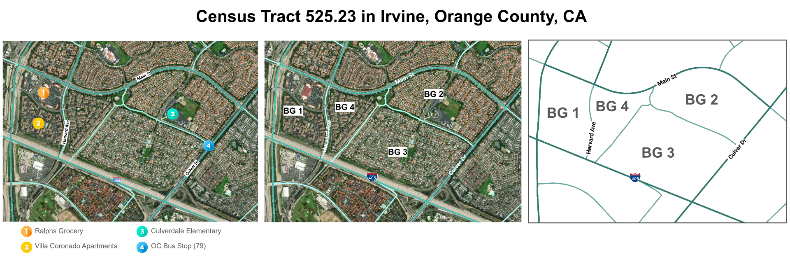

# Tutorial: Compare ACS 2024 1-Year and just-released ACS 2025 1-Year Data
By Thi Truong

Yesterday, I taught a session in the Community Geoscience Initiative Practicum about compiling data from the Decennial Census and ACS 5-year in the geographies of census tracts and block groups, which are [standard geographies from the Census](https://www.census.gov/programs-surveys/acs/geography-acs/concepts-definitions.html). 

Since this was the first synchronous session, the priority was to focus on those two datasets, Even though ACS 1-year data is important to understand, that would necessitate an additional lecture about places, cities, census designated places, and statistics, accuracy, and population sizes due to the heterogenous reliability of the estimates. 

Less than 24 hours later, however, today is the day that ACS 2025 1-Year data is published!

## Step 0. Basics

You need to have finished this first: [Tutorial: How to get a Census API Key up and running](https://github.com/thi-truong/census-prep/blob/main/01_tutorial_get_census_API_key_running.md)
 
First, verify the 2025 1-Year ACS data exists!
1. Open [Census Dataset Description Page](https://api.census.gov/data.html).
2. CTRL+F "2025" and you will find the ACS 1-year dataset pretty quickly.

For this tutorial, we'll use the Detailed Tables, which contain the most detailed cross-tabulations published for areas of 65,000+ populaton. The data are population counts. There are over 31,000 variables in this dataset.

## Step 1. Identify geography

[ACS 1-year estimate geographies](https://api.census.gov/data/2025/acs/acs1/geography.html) show a different lowest level compared to Decennial Census or ACS 5-year.  In this case, it's not a standard hierarchy unit, but "`PLACE`" , which exists in a two different formats. I prefer to use the FIPS 5-digit, also called `PLACEFP` because it is less digits to memorize.

### Finding values for `PLACE`
You can use the API URL query to print all of the places, but there are some easy options listed in Table 1, with examples of an Irvine Ralph's grocery address in the last one.

Table 1.1. Example ways to find PLACE/PLACEFP
| Tool  | Navigation steps for this tutorial | Link to output |
|--|--|--|
| U.S. Census Bureau   |  Code Lists: ANSI and FIPS Codes > [2020 Places](https://www.census.gov/library/reference/code-lists/ansi.html#place) > Select California  | [st06_ca_place2020.txt](https://www2.census.gov/geo/docs/reference/codes2020/place/st06_ca_place2020.txt) > Column "PLACEFP" | 
| TIGERweb | [State-Based Data Files](https://tigerweb.geo.census.gov/tigerwebmain/TIGERweb_state_based_files.html) > [Incorporated Places ACS 2025](https://tigerweb.geo.census.gov/tigerwebmain/TIGERweb_incplace_acs25.html) > [State of California](https://tigerweb.geo.census.gov/tigerwebmain/Files/acs26/tigerweb_acs26_incplace_2025_acs25_ca.html)  | <a href="https://tigerweb.geo.census.gov/tigerwebmain/Files/acs26/tigerweb_acs26_incplace_2025_acs25_ca.html">tigerweb_acs26_incplace_2025_acs25_ca.html</a>  >  Column "PLACE" | 
| Census Geocoder |  [Census Geocoder](https://geocoding.geo.census.gov/geocoder/) > Navigation:  Find Geographies > [One Line Address Processing](https://geocoding.geo.census.gov/geocoder/geographies/onelineaddress?form) > Benchmark/Vintage Census_2020 | <a href="https://geocoding.geo.census.gov/geocoder/geographies/onelineaddress?address=17605%20Harvard%20Ave,%20Irvine,%20CA%2092614&benchmark=2020&vintage=2020">Result for Ralph's address in Irvine</a>,  > Incorporated Places, row: "PLACE"

### Finding `PLACE` identifiers for Irvine and Santa Ana cities

I did not share Figure 1.1 (below) in class, though some groups worked on another census tract in Irvine. We are based in Orange County, California, so here, the examples shown will be for the cities of Irvine and Santa Ana. 

> **Figure 1.1.** Left: Area of Census Tract 525.23 in Irvine, CA. Satellite base map with features. Middle: Satellite view with block groups "BG" 1-4. Right: White background view of the boundaries.
> <figure> </figure>

In this tutorial we'll use two examples: Irvine city and Santa Ana city, which are in the same county and share some physical boundaries, administrative regions too, like parts of Santa Ana Unified School District. 

Moving on to ACS 1-year geographies of ``Place" as areas with 65,000+ population (a lot more than the 4,000-8,000 of a census tracts), the map below (Figure 1.2) shows the relative area difference of the cities, though they are the same type of statistical unit in this survey.

> **Figure 1.2.** City boundaries of Santa Ana and Irvine, Orange County. Data from <a href="https://data-ocpw.opendata.arcgis.com/datasets/OCPW::city-boundaries-4/about"> OC Public Works Open Data: City Boundaries</a> displayed in <a href="https://www.arcgis.com/apps/mapviewer/index.html?panel=gallery&layers=60119fce76d74dc08c3aa455f34b2b4d&catalog=701e29e22a9740029a3fa6139810f80a">ArcGIS Map Viewer</a></figcaption>
> <figure> </figure>

Using the above steps to find `PLACE`, Table 1.2 shows the 2 city's values.

**Table 1.2.** FIPS codes and Place information for Irvine and Santa Ana (Orange County, California)
| State | County | Place | Place Name | Type | 
|--|--|--|--|--|
| 06 | 059 | 36770| Irvine city | Incorporated Place|
| 06 | 059 | 69000 | Santa Ana city | Incorporated Place|

Let's recap the different low level geographies for a few recent Census and survey datasets.
**Table 1.3.** Characteristics of Census and ACS Surveys and Example Datasets

|  | Lowest Level  Geography  | Dataset   Path | Example API Query   (Vintage)  | Example Period|
|--|--|--|--|--|
| Decennial Census | Census Tract  | dec/dp | [Demographic Profile](http://api.census.gov/data/2020/dec/dp/examples.html) (2020) |  Apr 1, 2020 |
| ACS 5-year | Block Group  |acs/acs5  |[Detailed Table](https://api.census.gov/data/2024/acs/acs5/examples.html) (2024) | Jan 1 to Dec 31, 2024 |
| ACS 1-year | Place | acs/acs1 |[Detailed Table](https://api.census.gov/data/2025/acs/acs1/examples.html) (2025) | Jan 1 to Dec 31, 2025 |

## Step 2: Test API key with 2024 ACS 1-Year Data

### No variable, wildcard place

With wildcards for place and state. Copy and paste the URL and replace your key: 

``https://api.census.gov/data/2024/acs/acs1?get=NAME&for=place:*&in=state:*&key=[yourkeyhere]&descriptive=true``

These are the first six rows of the results:
> [["NAME","state","place"], 
> ["Geographic Area Name","State","Place"], 
> ["Auburn city, Alabama","01","03076"], 
> ["Birmingham city, Alabama","01","07000"], 
> ["Dothan city, Alabama","01","21184"], 
> ["Hoover city, Alabama","01","35896"],

#### Multiple variables, specified place

This requests 3 variables. Copy and paste the URL into your browser. Replace `[yourkeyhere]` with a working API key: 

``https://api.census.gov/data/2024/acs/acs1?get=NAME,B01001_001E,B01001_001M&for=place:36770,69000&in=state:06&key=[yourkeyhere]&descriptive=true``

These are the results you should get: 
> [["NAME","B01001_001E","B01001_001M","state","place"], 
> ["Geographic Area Name","Estimate!!Total:","Margin of Error!!Total:","State","Place"], 
> ["Irvine city, California","318693","56","06","36770"], 
> ["Santa Ana city, California","316188","66","06","69000"]] 

### Ensuring efficient comparisons with 2025 data

See the Table 2.1 for the components of the API query that we expect to remain the same or change between 2024-2025. You should evaluate each year periods for comparison.

**Table 2.1.** Explanation of API query components 2024 to 2025 ACS 1-Year comparison
| API URL Query Portion | Description | Change for different vintages/years |
|--|--|--|
| `https://api.census.gov/` | Base API URL | |
| `data/2024/acs/acs1?get=` | Dataset specification and get| Yes. E.g., replace `2024`  with `2025` | | 
| `NAME,B01001_001E,B01001_001M` | Variable names, separated by comma. A good practice to get margin of error for 1-year ACS. | Maybe. [1] | 
| `&for=place:36770,69000&in=state:06`| Requested cities in California | | 
| `&key=[yourkeyhere]` | Your API key, no brackets | |
| `&descriptive=true` | Optional print of second row as the variable names (very helpful) | | 

[1] - Review the Table Shells by Group for [2024](https://www2.census.gov/programs-surveys/acs/tech_docs/table_shells/2024/Shells/) results for [2024 Variables](https://api.census.gov/data/2024/acs/acs1/groups.html). Once you have identified variables,  chek the Table Shells by Group for [2025](https://www2.census.gov/programs-surveys/acs/tech_docs/table_shells/2025/Shells/). If the variable appears with no change in name or label, then it should be good to go for comparison. If there is a change, document it.

## Step 3: Make List of Variables for Queries

Following the advice above, Table 3.1. lists the variables for this study. For each one, I would also get the variable "M" which gives accompanying margin of error. Just keeping them out to keep this short(er).

**Table 3.1.** Estimates for ACS 2024 and ACS  2025 1-year query
|Group | Name| Label |  Component   of Total? |
|--|--|--|--|
| Sex by Age[2] |B01001_001E| Estimate!!Total |  |
| Vehicles Available   by Electric Vehicles[3]   | B25147_001E	| Estimate!!Total:| | |
|  | B25147_003E	| >  1 or more vehicles available |  001E |
|  | B25147_004E	| >  > Electric vehicle available |  001E, 003E |

[2] -  [B01001](https://api.census.gov/data/2024/acs/acs1/groups/B01001.html) (Sex by Age). Only extracting this to get a total population-- not extracting by age or sex. 
[3]  -  2025 only. [B25147](https://api.census.gov/data/2025/acs/acs1/groups/B25147.html) (Vehicles Available by Electric Vehicles). Universe: Within occupied housing units. Did not select no vehicles available for this. 

## Step 4: Perform queries

 ### Population
 A variable that exists both in 2024 and 2025, and all you have to change is the year
 
>  #### 2024
> 
> ``https://api.census.gov/data/2024/acs/acs1?get=NAME,B01001_001E,B01001_001M&for=place:36770,69000&in=state:06&key=[yourkeyhere]&descriptive=true``
> > Results:
> > 
> > [["NAME","B01001_001E","B01001_001M","state","place"], 
> > ["Geographic Area Name","Estimate!!Total:","Margin of Error!!Total:","State","Place"], 
> > ["Irvine city, California","318693","56","06","36770"], 
> > ["Santa Ana city, California","316188","66","06","69000"]]
> > 
> #### 2025
> 
> ``https://api.census.gov/data/2025/acs/acs1?get=NAME,B01001_001E,B01001_001M&for=place:36770,69000&in=state:06&key=[yourkeyhere]&descriptive=true``
> > Results:
> > 
> > [["NAME","B01001_001E","B01001_001M","state","place"], 
> > ["Geographic Area Name","Estimate!!Total:","Margin of Error!!Total:","State","Place"], 
> > ["Irvine city, California","318758","55","06","36770"], 
> > ["Santa Ana city, California","315562","76","06","69000"]]

### Electric Vehicles
A variable that is appearing for the first time in the ACS. Read more about the additions in the [2025 ACS 1-year New Tables](https://www.census.gov/programs-surveys/acs/technical-documentation/table-and-geography-changes/2025/1-year.html)

> #### 2025
> 
> ``https://api.census.gov/data/2025/acs/acs1?get=NAME,B25147_003E,B25147_003M,B25147_004E,B25147_004M&for=place:36770,69000&in=state:06&key=[yourkeyhere]&descriptive=true``
> > Results:
> > 
> > [["NAME","B25147_003E","B25147_003M","B25147_004E","B25147_004M","state","place"], 
> > ["Geographic Area Name","Estimate!!Total:!!1 or more vehicles available:","Margin of Error!!Total:!!1 or more vehicles available:","Estimate!!Total:!!1 or more vehicles available:!!Electric vehicle available","Margin of Error!!Total:!!1 or more vehicles available:!!Electric vehicle available","State","Place"], 
> > ["Irvine city, California","114413","4310","35708","3919","06","36770"], 
> > ["Santa Ana city, California","82582","3270","7958","1854","06","69000"]]

## Closing out

Yes, it is very unsatisfying to see a bunch of chunks of json fragments without any exploration. The next step is to tidy up the data and explore it with a set of questions written after reviewing the 2024 data, but before the 2025 data was released, in the spirit of preregistration and keeping things short. There is one more group of variables involved, but didn't list them here to keep it as minimal as possible. 

---

Markdown draft was made in [StackEdit](https://stackedit.io/).

Tutorial by Thi Truong is licensed under [CC BY 4.0](http://creativecommons.org/licenses/by/4.0).

Last updated October 29, 2026. 
